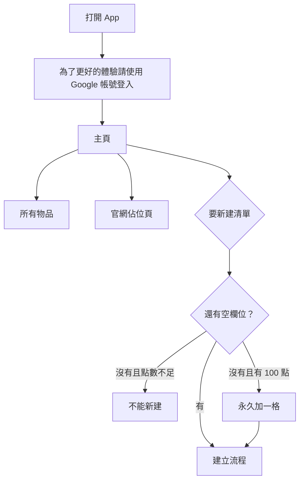
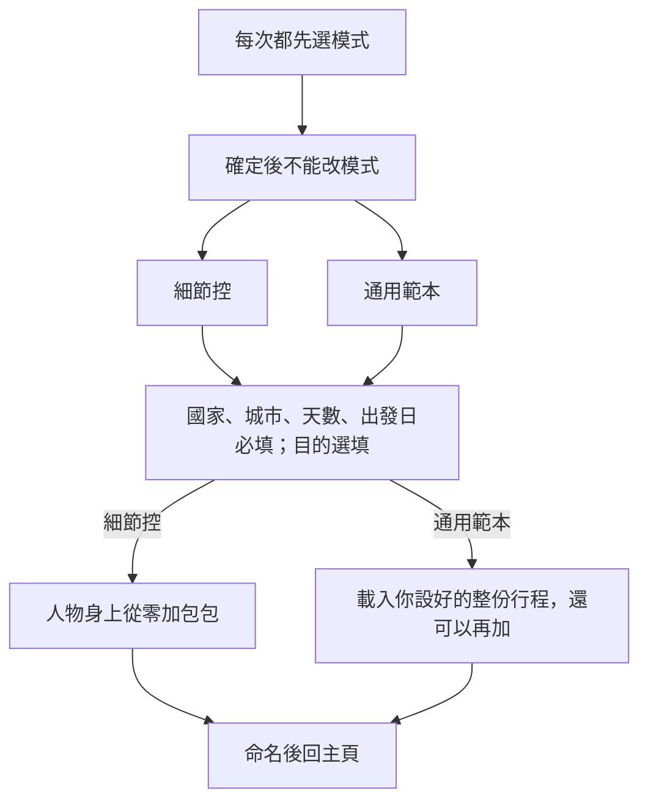
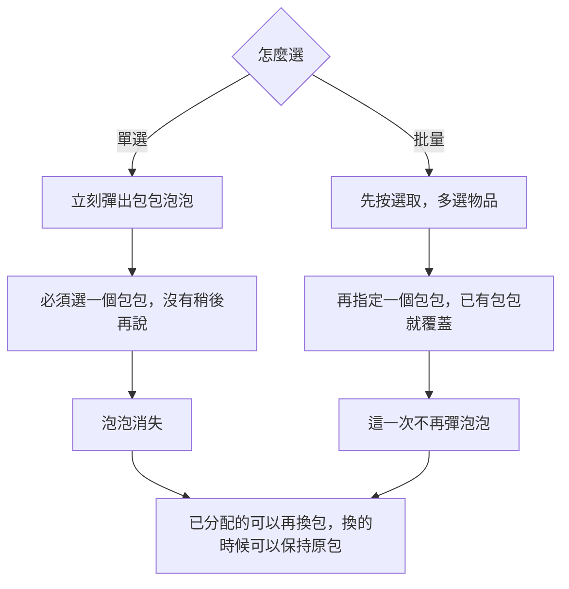
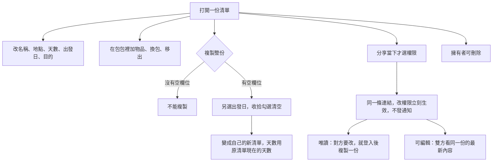

# 使用者體驗

手機線框。清單存在這台瀏覽器。登入可選旅人甲、旅人乙；接上 Supabase 後才會出現 Google。

## 打開之後

主頁左上是點數，右上是帳號名稱和累計旅行天數。清單卡片顯示名稱、包包圖示、旅遊期間。進行中和已結束看起來一樣，結束後仍可編輯。

一開始 2 個欄位。建立和複製只佔空欄位，不扣點。欄位滿了，主頁的「+」用 100 點永久再加一格。刪除會空出格子，不退點，欄位數也不減少。

累計旅行天數是自己目前擁有的清單、用現在的天數加總。3 天改成 9 天，這份就改計 9 天。別人分享來的不算。刪掉的清單離開加總，不會跟之後新建的那份疊加。

## 建立一份清單

出發日預填今天，可以改。結束日是出發日加上天數再減 1 天。國家和城市現在先手動輸入。世界地圖與各國地圖等圖檔。通用範本的行程清單在 `src/lib/trip-presets.ts`，還沒放資料。

選包時，下方橫向選種類，按加號才放進右邊清單。圖是已經上好色的素材，這一版不選顏色。同一種類再加，右邊那一列從名稱變成 X2。點右邊那一列可以改名稱或刪除。

## 物品怎麼進包包

建立當下的勾選是「放進這份清單」。進到清單頁之後，勾選變成「已收拾」。分類可以新增、移出、上移、下移、折疊已勾的項目。拖曳還沒做。

## 清單建好之後

可編輯的分享不佔對方的欄位。改成唯讀會立刻拿掉可編輯成員。
